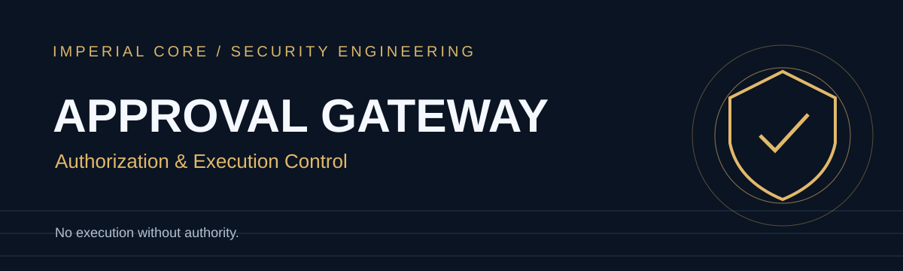

<p align="center"></p>

# APPROVAL GATEWAY

**Authorization & Execution Control · IMPERIAL Core**

*No execution without authority.*

Verifies Ed25519-signed laboratory execution permits, exact target digest, current veto epoch, scope, expiry and single-use consumption in a single synchronous process.

**Status: LOCAL TESTED REFERENCE / INDEPENDENT QA PENDING.** No production deployment, certification or real Owner enrollment is claimed.

## Quick start

Node.js 22.13+; no external dependencies or paid services. The local run in this iteration used Node.js 24.22.1.

```sh
npm test
```

Use `consumeApprovedPermit(...)` with a trusted decision key and `ReplayStore` for the local signed-decision reference. The legacy `consumePermit(...)` validates a permit but does not require a signed Guardian decision; it must not be used as a complete authorization boundary.

- [Architecture and release gates](ARCHITECTURE.md)
- [Threat model](THREAT_MODEL.md)
- [Security policy](SECURITY.md)
- [Source](src/index.mjs) · [Tests](test/reference.test.mjs) · [Local test evidence](evidence/LOCAL_TEST_EVIDENCE.md)
- [Authorship](AUTHORS.md) · [Roadmap](ROADMAP.md)

## Limitations

No approval issuer, real Owner enrollment, Face ID, distributed replay protection or external execution. The optional SQLite store uses local transactions; trusted state and the store are supplied by a laboratory host.

## Related components

[ZERO TRUST](https://github.com/oromaskevic23-cmd/ZERO-TRUST) · [GUARDIAN CORE](https://github.com/oromaskevic23-cmd/GUARDIAN-CORE) · [APPROVAL GATEWAY](https://github.com/oromaskevic23-cmd/APPROVAL-GATEWAY) · [AUDIT LEDGER](https://github.com/oromaskevic23-cmd/AUDIT-LEDGER) · [CYBER HAK](https://github.com/oromaskevic23-cmd/CYBER-HAK-Public)

## Founder and authorship

<p align="center"></p>

**Alexander Nikolaevich Romaskevich (RomaskevicH)** — Founder • Owner • CEO, IMPERIAL Core. Architect / Final Architectural Decision Authority.

Public source visibility is not a license grant. See [LICENSE](LICENSE).

**Architecture Before Implementation. Evidence Before Trust.**

## Local atomic consumption evidence

[ReplayStore](src/replay-store.mjs) records a consumed permit and a digest-only outbox entry in the same SQLite transaction. The verifier supplies a digest of the exact permit payload; direct manual store additions have no verified permit digest. `pendingEvents(after, limit)` lets a trusted host retrieve the entries for audit import. The outbox is not proof of delivery, immutable storage or a replacement for Audit Ledger; historical consumptions are not backfilled. The host must manage delivery, retention and durable external evidence.

SQLite files are created with owner-only POSIX permissions; existing files with broader permissions and symlinks are rejected on POSIX. Use a trusted directory and protect the database against replacement. Windows ACL enforcement is not implemented or tested.

## Security hardening v0.2

[Implementation](src/replay-store.mjs) · [Tests](test/replay-store.test.mjs) · [Evidence and limitations](docs/HARDENING_V0_2.md).

## Security composition v0.3

An additional signed authorization decision binds the exact permit digest, current policy epoch and veto epoch. Trusted host supplies current state and independently pinned signing authorities. Legacy APIs remain; no production issuer, distributed atomicity or external execution is claimed.

[Implementation](src/decision-bound.mjs) · [Tests](test/decision-bound.test.mjs) · [Scope and evidence](docs/COMPOSITION_V0_3.md).
